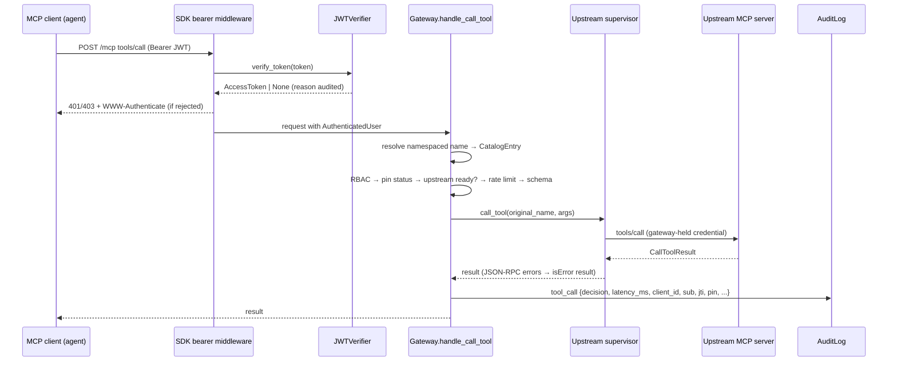

# mcpgate architecture

This document covers how the gateway is put together, the algorithms behind its security
controls, and what each costs. The README has the overview. `docs/THREAT_MODEL.md` explains
why each control exists.

## 1. Module map

| Module | Responsibility | Depends on |
|---|---|---|
| `errors` | `GatewayError` hierarchy: `ConfigError`, `AuthError(reason)`, `PinStoreError`, `AuditError`, `UpstreamError`, `CatalogError` | — |
| `canonical` | RFC 8785-style canonical JSON + `sha256:` digests | — |
| `config` | Pydantic models for the YAML file; `${VAR}` expansion (unset = error); path resolution against the config directory | `errors` |
| `auth` | `JWKSStore` (local file, reload on mtime change / unknown `kid`), `JWTVerifier` (SDK `TokenVerifier`), `Principal` | `config`, `errors` |
| `devissuer` | Dev-only ES256/EdDSA key generation and token minting | — |
| `policy` | RBAC: roles from client binding ∪ `scope_roles`; allow/deny globs; verdict cache | `config` |
| `ratelimit` | Token buckets per client and per (client, tool rule); LRU-bounded | `config` |
| `validation` | Size/depth caps + JSON Schema validation with a fetch-free registry; compiled-validator cache by pin digest | `config` |
| `fingerprint` | The pinned view of a tool, per-field digests, JSON-pointer diffs | `canonical` |
| `lint` | Heuristic "tool poisoning" findings | — |
| `pinning` | `PinStore` (flock + atomic replace) and `PinManager` (TOFU, reconcile, approve, live reload) | `fingerprint`, `config` |
| `catalog` | Namespaced aggregate of all upstream listings; opaque pagination cursors | `fingerprint` |
| `audit` | Hash-chained JSONL writer, argument summarisation/redaction, `verify_chain` | `canonical` |
| `upstream` | One supervisor per upstream: SDK `Client` over stdio or Streamable HTTP, backoff, heartbeat re-listing, `list_changed`, bounded concurrency | `canonical`, `config` |
| `gateway` | Composes everything around an SDK low-level `Server`; HTTP app with SDK bearer auth; stdio serving; health | all of the above |
| `client` | `connect_gateway(url, token)`: an SDK client with a bearer header | — |
| `agent` | Minimal tool-calling loop; `OllamaProvider` and `ScriptedProvider` | `client` (via MCP) |
| `cli` | `serve`, `check-config`, `catalog`, `pins`, `audit`, `keys`, `token` | most modules |
| `samples/*` | Two sample MCP servers (notes on stdio, inventory on HTTP) with clean and altered variants | SDK only |
| `demo` | The `make demo` script | everything |

`wc -l src/mcpgate/*.py src/mcpgate/samples/*.py` reports 4,183 lines, including docstrings and the
403-line demo script.

## 2. Request path



The order of checks is chosen on purpose:

1. **Resolve, then RBAC.** An unknown name and a forbidden name both raise
   `INVALID_PARAMS "tool not found or not permitted"`, so a client cannot probe for tools. The
   audit log keeps the real reason.
2. **Pin status before anything costly.** A quarantined tool is refused even for operators.
3. **Rate limit before validation.** A client cannot buy unlimited schema validation by sending
   invalid arguments in a loop.
4. **Validation last before forwarding.** It runs against the schema whose digest is the pinned
   one, since the tool would otherwise be quarantined.

Denials after RBAC (quarantine, unavailable upstream, rate limit, invalid arguments, upstream
failure) come back as `isError` tool results, not protocol errors. An LLM reads those as an
observation and can recover, and `_meta["io.github.mcpgate/decision"]` carries a
machine-readable decision. A protocol error from a tool call usually ends an agent's turn.

## 3. Upstream supervision

Each `Upstream` runs a supervisor loop:

```
while not stopped:
    open SDK Client (stdio subprocess or Streamable HTTP with gateway-held headers)
    list tools (all pages, cache_mode="refresh") → publish to gateway (catalog + pins + lint)
    state = ready; reset backoff
    wait for: reconnect request | stop | heartbeat failure
        heartbeat: every heartbeat_s re-list; publish only if the listing digest changed
on failure: state = down; sleep backoff (0.5 s doubling to 30 s), retry
```

* The SDK client's response cache is disabled (`cache=None`). Otherwise a cached `tools/list`
  could hide a changed definition from the pin check.
* `notifications/tools/list_changed` from an upstream schedules an immediate refresh.
* Heartbeat re-listing does two jobs. It is the liveness probe (`ping` is not in the 2026-07-28
  stateless protocol), and it is a continuous pin check that catches in-session definition
  changes (`tests/test_upstream.py::test_heartbeat_relisting_catches_in_session_change`).
* Calls borrow the live client through an `anyio.CapacityLimiter(max_concurrency)` with a
  per-call timeout. Connection-level failures trigger a reconnect. JSON-RPC errors from the
  upstream become `isError` results.

## 4. Tool-definition pinning

### Fingerprint

```
pinned_view(tool) = {name, title?, description?, inputSchema, outputSchema?, annotations?}   (wire/camelCase)
digest            = "sha256:" + hex(SHA-256(canonical_json(pinned_view)))
field_digests     = {field: digest(value) for each field}
```

`_meta`, `icons` and the era-specific `execution` block are excluded. They do not steer the
model and they legitimately differ between protocol versions. The benchmark's mutation matrix
(`make bench`) checks that a re-ordered but otherwise identical definition and a `_meta`-only change are
*not* flagged, while hidden instructions, a single zero-width space, a new optional parameter, a
removed `maximum`, a loosened `required`, a flipped `destructiveHint`, an added `title` and an
added `outputSchema` all are.

### Canonical JSON

`canonical.py` follows RFC 8785 for everything MCP payloads contain. Keys are sorted by UTF-16
code units, there is no whitespace, strings are escaped minimally, integers are printed exactly,
integral floats collapse (`1.0` → `1`), `-0.0` → `0`, and NaN/Infinity are rejected.
**Documented deviation:** non-integral floats use Python's shortest round-trip `repr` with
the exponent normalised to `e+N`/`e-N`. That matches ECMAScript for the ranges that appear in JSON
Schemas, but it is not a proven match for every double. It cannot cause a false match or
mismatch inside mcpgate, because both sides of every comparison are produced by the same function.
A pin store shared with a different JCS implementation could disagree on exotic floats.
Property tests (`tests/test_canonical.py`, Hypothesis) check that the encoding is idempotent and
order-independent and that it round-trips through `json.loads`.

### Reconcile algorithm

On every published listing for upstream `u` with observed fingerprints `O`:

```
if u not in store:            pin all of O (TOFU); event tofu
else for (name, fp) in O:
    pin = store[u].tools.get(name)
    if pin and pin.digest == fp.digest:   clear pending[name] (event "reverted" if it was pending)
    elif pin is None and on_new_tool == "pin":  pin it; event new_tool_pinned
    else: pending[name] = fp; event changed|new_tool, unless the same digest is already pending
removed = pinned − observed  → event removed (once, tracked in store[u].missing)
drop pending entries whose tool vanished
```

* **Quarantine is derived, not stored.** `status(u, tool, observed)` compares the *observed*
  digest with the pin on every list/call. If the upstream reverts, the tool is served again
  with no operator action. When an operator approves, the pin changes and the block lifts.
* **Live approval.** `mcpgate pins approve` writes the store under `flock`. A running gateway
  checks the store's `st_mtime_ns` on each lookup and reloads, so no restart is needed
  (`tests/test_pinning.py::test_approval_by_another_process_is_seen_live`).
* **Alert de-duplication.** A pending change is alerted once per distinct observed digest, so a
  60 s refresh loop does not flood the log.
* **Diffs.** `describe_change` lists changed fields, a unified diff of the description and a
  JSON-pointer diff of each schema (`+ /properties/context`), which is what the demo prints.

Complexity: fingerprinting a tool is O(s log s) for a definition of size s (key sorting).
Reconciling n tools is O(n) dictionary work plus one store read and write (O(total store size)).
A status lookup is O(1) plus one `stat` call.

## 5. Authentication

`JWTVerifier.verify` runs these steps in order. Each one has its own `AuthError.reason`, which
is audited as `auth_rejected`:

1. length ≤ `max_token_bytes` (8 KiB) → `malformed_token`
2. mcpgate parses the JOSE header itself: `alg` must be in the configured *asymmetric* allowlist
   (`config` rejects `none` and `HS*` at load time), `crit` is refused, `typ` must be in
   `accepted_typ` (`at+jwt`, `JWT`)
3. key lookup by `kid`. On a miss, the JWKS file is reloaded at most once per
   `jwks_reload_min_interval_s`, which is how key rotation is picked up. A reload that fails
   keeps the last good key set. The key's own `alg` and `use` must agree with the header.
4. signature (PyJWT + `cryptography`)
5. `iss` exact match. `aud` must contain the resource URL (`listen.public_url` or the listen
   address + path). `exp`, `nbf` and `iat` are checked with leeway ≤ 300 s.
6. `sub` and `client_id`/`azp` must be non-empty strings. Scopes come from `scope` (space-
   delimited) or `scp`.

The SDK's `RequireAuthMiddleware` then enforces `required_scopes` (403 `insufficient_scope`).
It also serves RFC 9728 protected-resource metadata at
`/.well-known/oauth-protected-resource/mcp`. `_DenialAuditor` wraps the ASGI app and logs
every 401/403 on the MCP path, including requests that carried no token and so never reached
the verifier.

Cost: about 0.1 ms per ES256 verification on the bench machine (`make bench`). No network I/O.

## 6. RBAC

```
roles(client, scopes) = clients[client].roles ∪ {scope_roles[s] for s in scopes if s in scope_roles}
allowed(tool)         = ∃ r ∈ roles: any(fnmatchcase(tool, g) for g in r.allow)
                        ∧ ∄ r ∈ roles: any(fnmatchcase(tool, g) for g in r.deny)
```

Deny wins, and an unknown client has no roles, so the default is deny. Verdicts are cached
per `(sorted role tuple, tool)` in an `lru_cache(maxsize=4096)`, which is O(1) after the first
evaluation (about 0.4 µs in the benchmark). Both key parts come from configuration and the
catalog, not from free-form client input, so the cache cannot be flooded by a caller.

## 7. Rate limiting

A continuous-refill token bucket: `tokens = min(burst, tokens + Δt·rate)`. A call needs one
token from the client bucket (or its `client_overrides` rule) *and*, when the tool matches a
`per_tool` glob, one from the (client, first matching glob) bucket. Every bucket is
checked before any is debited, so a rejected call costs nothing, and the rejection carries
`retry_after_s = (1 − tokens)/rate` of the binding bucket. Buckets live in an `OrderedDict`
LRU capped at `max_tracked_buckets` (10,000 by default). Evicting a bucket is safe because a
new bucket starts full, exactly like an idle one that has refilled. Cost is O(1) time per check
and O(K) memory for K active keys. The clock is injectable, so tests are deterministic.

## 8. Argument validation

1. Size: `len(canonical_json(args)) ≤ max_argument_bytes`. Depth: an iterative walk that stops
   once it passes `max_argument_depth`. Both are linear and run before schema validation.
2. Validator class from the schema's `$schema` (Draft 2020-12 when absent, as MCP specifies),
   with format assertion on.
3. A `referencing.Registry` that holds only the bundled meta-schemas and has no retriever, so a
   remote `$ref` fails instead of being fetched (`tests/test_validation.py::test_remote_refs_are_never_fetched`).
4. Compiled validators are cached per pin digest (the cache is cleared once it passes 4,096 entries). Errors are reported as
   `$.path: violates 'keyword' (schema expects X)` and never echo the rejected value.

## 9. Audit log

Each record is `{seq, ts, event, ..., prev, hash}`, where
`hash = SHA-256(canonical_json(record without hash))` and `prev` is the previous record's hash
(64 zeros for the first). The writer appends under a `threading.Lock` to a file opened
`O_APPEND` with mode 0600. When it starts, it reads the last line to continue the chain, and
it refuses to extend a log whose last line is corrupt. `verify_chain` streams the file, recomputes
every hash and link, and reports the first bad line. With `--expect-head` it also checks that
the head equals an externally anchored value, which is the only way to detect tail truncation.
Verification is O(N) time and O(1) memory. An append costs about 30 µs without fsync
(`make bench`).

## 10. Protocol versions and transports

The gateway is an SDK `mcp.server.lowlevel.Server` (SDK 2.3.x). One server object handles the
2025-11-25 initialize-handshake protocol and the 2026-07-28 stateless protocol.
`tests/test_integration_http.py::test_rbac_over_both_transports_and_protocol_eras` runs RBAC
checks in both eras. Upstreams are reached through the SDK `Client` over stdio
(`StdioServerParameters`) or Streamable HTTP (`streamable_http_client` with an `httpx2` client
that carries the gateway-held headers). The gateway itself serves Streamable HTTP (OAuth) or
stdio (fixed `stdio_identity`).

## 11. Testing strategy

| Layer | What | Where |
|---|---|---|
| Unit | canonical JSON (with Hypothesis properties), auth rejection table, RBAC, buckets, validation, fingerprints/lint, pin store, audit chain/tamper cases, config, CLI | `tests/test_*.py` |
| In-process gateway | SDK `Client(server)` against the gateway with in-memory sample upstreams: namespacing, denial indistinguishability, rate limits, rug pull, warn mode, upstream down, pagination | `tests/test_gateway_inproc.py` |
| Integration | real subprocess upstreams (stdio notes + HTTP inventory with a required credential), gateway on a real socket with JWT auth, both protocol eras, HTTP rug pull, crash recovery | `tests/test_integration_http.py`, `tests/test_integration_stdio.py` (marker `integration`) |
| Agent | scripted provider loop, Ollama request/response mapping against a fake HTTP transport | `tests/test_agent.py` |

No test needs the network, Docker or Ollama. `make check` enforces ≥ 85 % branch coverage over
`src/mcpgate`, excluding only the demo script and `__main__`.
