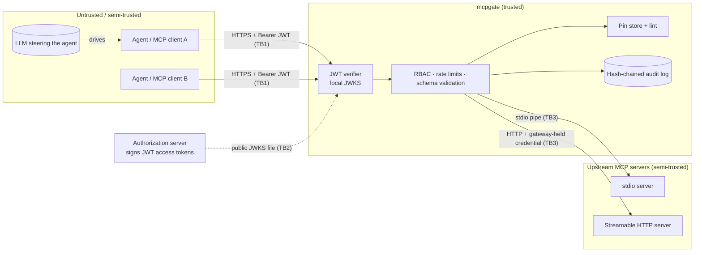

# mcpgate threat model

This document states what mcpgate defends against, what it assumes, and where it stops. It is
written for an operator deciding whether to put mcpgate between agents and MCP servers, and for
a reviewer checking that the controls in the code match the claims in the README.

mcpgate is a portfolio project. It has not been externally audited and has no production
deployments. Everything below describes the code in this repository and the tests that
exercise it.

## 1. System and trust boundaries

| Boundary | Crosses it | Trust assumption |
|---|---|---|
| TB1 client → gateway | JSON-RPC over Streamable HTTP with a bearer JWT | Clients and the model driving them may be confused, prompt-injected or malicious. |
| TB2 authorization server → gateway | A JWKS file on local disk | The file's integrity is the operator's job (config management, file permissions). |
| TB3 gateway → upstream | MCP over stdio (subprocess) or HTTP | Upstreams are semi-trusted: approved once, but may change later ("rug pull"), be compromised, or be buggy. |
| Operator → gateway | YAML config, pin store, `mcpgate pins approve` | Trusted. Anyone with write access to config or pin store controls the gateway. |

## 2. Assets

1. **Upstream capabilities**, meaning what the tools can do (adjust stock, delete notes, and so on).
   The main asset is "only the right client can invoke the right tool with sane arguments".
2. **Upstream credentials** that the gateway holds (e.g. `INVENTORY_TOKEN`). Clients must never see
   or relay them.
3. **The model's context.** Tool names, descriptions and schemas are read by the LLM as
   instructions, so their integrity matters as much as the integrity of code.
4. **The audit trail.** After an incident it is the evidence of who called what and what the
   gateway decided.

## 3. Threats and controls (STRIDE-style)

Each row names the control and the test that exercises it. Paths are relative to the repo root.

### Spoofing

| Threat | Control | Evidence |
|---|---|---|
| Unauthenticated caller | SDK bearer middleware + `JWTVerifier`; 401 with `WWW-Authenticate` and RFC 9728 metadata | `tests/test_integration_http.py::test_requests_without_valid_tokens_are_refused` |
| Forged token / `alg: none` / HMAC confusion with a public key | Algorithm allowlist is asymmetric only (`config.AuthConfig._asymmetric_only`); the header is parsed by mcpgate itself; the key's own `alg`/`use` must agree | `tests/test_auth.py` |
| Token minted for another resource replayed here (token passthrough) | `aud` must contain the gateway's resource URL (RFC 8707 audience binding) | demo section 1, `tests/test_auth.py` |
| Expired / not-yet-valid tokens | `exp`/`nbf`/`iat` with bounded leeway (≤ 300 s) | `tests/test_auth.py` |
| Unknown `kid` used to make the gateway fetch keys | No network fetch at all; an unknown `kid` causes at most one local-file reload per `jwks_reload_min_interval_s` | `tests/test_auth.py` |
| Header tricks (`crit`, oversized tokens) | `crit` refused, `typ` checked, 8 KiB size cap before parsing | `tests/test_auth.py` |

### Tampering

| Threat | Control | Evidence |
|---|---|---|
| **Rug pull**: an upstream changes a tool's description or schema after approval | Tool-definition pinning: SHA-256 over the canonical JSON of name, title, description, inputSchema, outputSchema and annotations. In `enforce` mode a changed tool is hidden and refused until `mcpgate pins approve`. | `tests/test_pinning.py`, `tests/test_integration_http.py::test_http_upstream_rug_pull_is_quarantined`, `benchmarks/bench.py` mutation matrix, demo section 5 |
| New tool slipped into an approved server | `on_new_tool: quarantine` (default) | `tests/test_pinning.py::test_new_and_removed_tools` |
| A cached listing hides a change | SDK client cache disabled (`cache=None`), `cache_mode="refresh"` on every listing, periodic re-listing via heartbeat, `tools/list_changed` handled | `tests/test_upstream.py` |
| Malformed or oversized arguments from a confused model | Size and depth caps first, then JSON Schema validation (draft from `$schema`, 2020-12 by default) before forwarding | `tests/test_validation.py`, demo section 4 |
| Hostile schema causes the gateway to fetch remote `$ref`s (SSRF) | Validator uses a registry with no retriever | `tests/test_validation.py` |
| Editing the audit log after the fact | Hash chain (`prev`/`hash`, canonical JSON); `mcpgate audit verify` finds the first broken line | `tests/test_audit.py`, demo section 6 |
| Concurrent writers corrupt the pin store | `flock` on a sidecar lock + temp file + `os.replace`; mode 0600 | `tests/test_pinning.py::test_store_is_atomic_private_and_validated` |

### Repudiation

Every decision is logged: `tool_call` with `decision` ∈ {allowed, unknown_tool, denied_policy,
quarantined, upstream_unavailable, rate_limited, invalid_arguments, upstream_error}, `tools_list`,
`auth_rejected` (with the verifier's precise reason), `http_denied` (401/403 at the HTTP layer,
including missing tokens), `pin_alert`, `tool_lint`, `upstream_state`. Records carry `client_id`,
`sub` and `jti` from the token. The demo prints the audit log next to the agent's own summary
because the agent's narrative is not reliable evidence (see the real Ollama run in the README).

### Information disclosure

| Threat | Control |
|---|---|
| Catalog enumeration: learning which tools exist that you may not use | `tools/list` returns only permitted, non-quarantined tools on ready upstreams; an unknown tool and a forbidden tool return the same JSON-RPC error (`tool not found or not permitted`). |
| Upstream credentials leaking to clients | The gateway injects upstream headers itself. Client tokens are never forwarded (no passthrough). Demo section 4 shows a client token sent straight to the upstream gets HTTP 401. |
| Secrets in arguments ending up in logs | Audit argument mode `digest` (default) keeps only a SHA-256 plus top-level keys; `redacted` masks secret-looking keys and truncates long strings; validation errors name the failing path and keyword, never the value. |
| Tool shadowing across servers | Namespacing `<upstream>__<tool>` with upstream names restricted to `[a-z][a-z0-9-]*` that cannot contain the separator, so two upstreams cannot collide. The lint also flags descriptions that mention another server's tools. |

### Denial of service

| Threat | Control |
|---|---|
| One client floods a tool | Token buckets per client and per (client, tool glob). Both are checked before either is debited. LRU-bounded at `max_tracked_buckets`. |
| A slow upstream ties up the gateway | Per-upstream `CapacityLimiter` (`max_concurrency`) and a per-call timeout |
| A crashing upstream | Supervisor reconnects with capped exponential backoff (0.5 s → 30 s); calls fail fast as `upstream_unavailable` meanwhile; tested in `tests/test_integration_stdio.py` with `tests/fixtures/crashy_server.py` |
| Expensive validation from deep or huge payloads | Linear-time size/depth pre-check before schema validation; compiled validators cached per pin digest |
| Unbounded upstream pagination | At most 100 `tools/list` pages per listing |

### Elevation of privilege

| Threat | Control |
|---|---|
| A client calls a tool outside its role | Default-deny RBAC; deny globs beat allow globs; roles come from the client binding plus `scope_roles`. Enforced on `tools/call`, not just hidden from `tools/list`. |
| Prompt-injected agent tries a destructive tool | It only reaches tools its client is granted (demo section 3: the real model "claimed" to adjust stock, and the audit log shows zero stock-changing calls reached the upstream). |

## 4. Tool-poisoning lint

`mcpgate.lint` flags suspicious text in tool definitions: invisible Unicode, "ignore previous
instructions", concealment ("do not tell the user"), `<IMPORTANT>`-style tags, sensitive paths
(`~/.ssh`, `id_rsa`, `.env`, `mcp.json`), exfiltration phrasing, "before using this tool" and
cross-server tool references. It **reports and does not block**. It is a regex heuristic: an
attacker who knows the patterns can rephrase around them, and benign descriptions can trip
them. It mainly matters for the first definition seen, which TOFU pinning would otherwise
accept without comment.

## 5. Explicit non-goals and residual risk

These are real gaps. An operator should know them before relying on mcpgate.

1. **Trust on first use.** The first definition seen is pinned automatically. If an upstream is
   malicious from day one, pinning cannot help. Only review (helped by the lint and
   `mcpgate catalog`) can. Pre-seeding a reviewed pin store is the mitigation.
2. **Pinning covers definitions, not behaviour.** A server can keep its description identical
   and change what the tool does, or return injected text in tool *results*. mcpgate does not
   inspect or sanitise results.
3. **Window between change and detection.** A change is caught at the next listing: a
   reconnect, a `tools/list_changed` notification, the heartbeat (default 15 s) or the refresh
   loop (default 60 s). Calls in that window use the previously observed definition.
4. **Bearer tokens are replayable** within their lifetime. There is no DPoP or mTLS sender
   constraint and no `jti` replay cache (`require_jti` only checks presence). Keep token TTLs short.
5. **No token introspection or revocation.** Validation is purely local (JWKS file). A revoked
   but unexpired token is accepted until `exp`.
6. **The audit chain does not prove completeness.** Truncating the tail is only detected with an
   externally anchored head (`mcpgate audit verify --expect-head`). Someone with write access to
   the file can also rewrite the whole chain consistently. Anchoring the head elsewhere (a
   WORM bucket, a ticket, a signed timestamp) is left to the operator. `fsync` is off by
   default, so the last records can be lost on power failure.
7. **stdio transport has no authentication.** Callers on the gateway's own stdio get the
   configured `stdio_identity`. That is meant for a single local agent process.
8. **TLS is not terminated by mcpgate.** It listens on plain HTTP and is meant to sit behind a
   TLS-terminating proxy, with `listen.public_url` set so the token audience matches.
9. **Rate limits are per process.** Several gateway replicas do not share buckets.
10. **Upstream stdio servers inherit the gateway's environment** unless `env` is set per
    upstream. Least privilege for subprocesses (separate users, sandboxes) is out of scope.
11. **The dev issuer (`mcpgate keys`/`token`) is for development only.** It writes a private key
    to disk and mints arbitrary tokens. Production uses a real authorization server's JWKS.

## 6. Safe-lab note

The "poisoned" and "drifted" sample-server variants only contain *text* that describes malicious
intent, so detection can be tested. They never read files or send data anywhere. Every demo and
test runs on 127.0.0.1 against servers in this repository.
